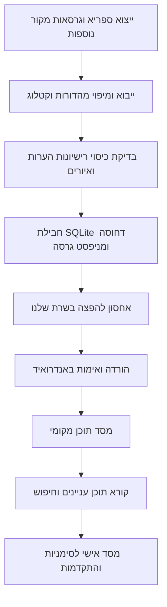

# ספריית לימוד מקומית — שולחן ערוך אדמו״ר הזקן

תאריך מחקר: 8 באוקטובר 2026. מסמך מחקר המקורות והאפיון המקורי; גוף הספר והלכות תלמוד תורה הוטמעו לאחר מכן בגרסה 1.2.

עדכון מימוש: גוף הספר מהייצוא הראשי שולב בגרסה 1.2 ללא הערות ואיורים לפי בקשת המשתמש.
התיעוד של התכונה שבוצעה נמצא ב־[ספריית שולחן ערוך](android-shulchan-aruch.md).
המסמך להלן הוא מחקר המקורות והאפיון המקורי; אין לראות בכל רכיב שהוצע בו רכיב שכבר מומש.

## ההחלטה המומלצת

להקים ספריית טקסט עצמאית באנדרואיד: חבילת תוכן עברית מבוקרת וממוספרת גרסה, הורדה בפעם הראשונה שהאפליקציה נפתחת לאחר ההתקנה, מסד SQLite מקומי, וקורא Compose. כל הקריאה, החיפוש, הסימניות והתקדמות הלימוד יעבדו מקומית אחרי ההורדה. השרת משמש להפצת חבילות ועדכונים.

החלטה זו נשענת על בדיקת קובצי המקור עצמם, קטלוג ספריית חב״ד וקוד האפליקציה. נבדקו 16 קובצי ייצוא עבריים, כולל מהדורות ומיזוגים, ולא רק דוגמאות של סימן אחד. התוצאה החשובה: אין קובץ יחיד שכבר הוכח כ״כל הספר, עם כל ההערות, ורישיון אחיד״.

המשמעות המעשית: אפשר לבנות את התשתית ואת רוב תוכן הספר ממקורות קיימים, אך הכותרת ״המהדורה המלאה״ מחייבת השלמת בדיקת כיסוי, מיפוי הערות ובירור הרשאות לפריטים החסרים. אין להחליף חוסר בטקסט מומצא או בערבוב מהדורות ללא תיעוד.

## 1. מה נמצא במקורות בפועל

### ספריא — מקור מובנה ומרוכז

הייצוא הרשמי זמין ב־Google Cloud Storage. מאגר GitHub הוא כיום אינדקס וכלי הורדה; הנתיבים הישנים של קובצי הטקסט בתוך GitHub אינם שיטת ההורדה הנוכחית. המקור מתאר מיזוגים כצירוף תוכן ממהדורות שונות. לצורך ההפצה שלנו עדיף לבחור מהדורות מפורשות ולשמור מקור לכל יחידה. [מאגר הייצוא הרשמי](https://github.com/Sefaria/Sefaria-Export).

נבדק הייצוא המעודכן ל־1 באוקטובר 2026, והמטא־דאטה החי של ה־API ביום המחקר:

| ספר / מהדורה | יחידות טקסט לא ריקות | ממצא | רישיון במטא־דאטה |
|---|---:|---|---|
| שולחן ערוך הרב — קה״ת ללא ניקוד | 7,011 | כולל 660 סעיפים בענף הראשי של יורה דעה; חסרים ביחס למיזוג 66 פסקאות הקדמה, 69 יחידות מהדורא בתרא וכתובת אחת באורח חיים | CC-BY-NC |
| שולחן ערוך הרב — קה״ת מנוקד | 6,487 | כולל הקדמה ומהדורא בתרא; כל 660 הסעיפים בענף הראשי של יורה דעה אינם קיימים במהדורה זו | CC-BY-NC |
| שולחן ערוך הרב — merged | 7,147 | מכסה את איחוד כתובות שתי המהדורות, אך אינו מקור עם רישיון עצמי מאומת | לא מצוין |
| קונטרס אחרון — קה״ת | 607 | ספר נפרד, שיש למפות לקטעים בקורא | CC-BY-NC |
| הלכות תלמוד תורה — קה״ת מנוקד | 54 | ארבעה פרקים | לא מצוין |
| הלכות תלמוד תורה — Wikisource בספריא | 27 | כולל רק פרקים א–ב | CC-BY-SA |
| פסקי הסידור — קה״ת מנוקד | 384 | חיבור נפרד; קיים גם צומת ריק בשם The Seder | unknown |
| סדר ברכת הנהנין — קה״ת מנוקד | 224 | כולל הקדמה ו־13 פרקים | unknown |

הספירות כוללות סעיפים, פסקאות הקדמה ויחידות מסוגים שונים; אין להציג את 7,147 כמספר ״סעיפים״. הן מראות כיסוי מכני של כתובות, ולא הוכחה לשלמות הנוסח מול ספר מודפס. ראיות מלאות, חותמות זמן, כתובות מקור ו־SHA-256 נמצאות ב־[דוח הבדיקה](../research/shulchan-arukh-harav-audit.json).

שתי מהדורות הליבה אינן שתי תצוגות של אותו טקסט. ברירת המחדל המוצעת, בכפוף לאימות עריכתי: להשתמש במנוקדת במקום שבו היא קיימת, ובלא־מנוקדת להשלמת הכתובות החסרות, עם סימון מהדורה ורישיון לכל יחידה. אין לייצר ניקוד אוטומטי כדי להסתיר את ההבדל. אפשרות נוספת היא קריאה במהדורה מוגדרת, עם מעבר מפורש למהדורה אחרת במקום החסר.

### הלכות תלמוד תורה — מקור ישיר מלא יותר מהעותק בספריא

בוויקיטקסט עצמו נמצאו ארבעת הפרקים. ה־API החזיר כותרות של 14, 13, 8 ו־19 סעיפים, סך הכול 54, וגם כותרת קונטרס אחרון בכל פרק. נשמרו מזהי הגרסאות: א — 1405924; ב — 1405923; ג — 941700; ד — 3011240. אלה נתוני כותרות; טרם בוצעה הגהה מלאה של כל הנוסח.

האתר מציין CC-BY-SA 4.0, והדפים מסומנים ״לא בדוק״. לכן זו חלופה מעשית לייבוא ישיר עם ייחוס, קישור לגרסה ותיעוד התאמות, אך יש להשוות את הטקסט למקור סמכותי לפני שחרור. העותק החלקי בספריא אינו סיבה להשמיט את פרקים ג–ד. [דף החיבור](https://he.wikisource.org/wiki/שולחן_ערוך_הרב_הלכות_תלמוד_תורה), [פרק ג](https://he.wikisource.org/wiki/שולחן_ערוך_הרב_הלכות_תלמוד_תורה_פרק_ג), [פרק ד](https://he.wikisource.org/wiki/שולחן_ערוך_הרב_הלכות_תלמוד_תורה_פרק_ד), [תיעוד API של MediaWiki](https://www.mediawiki.org/wiki/API:Parsing_wikitext).

### ספריית חב״ד — בסיס לתוכן העניינים ולבדיקת הכיסוי

נבדק הקטלוג העדכני של [שולחן ערוך בספריית ליובאוויטש](https://www.chabadlibrary.org/books/3100000000). האתר משתמש ב־endpoint קריאה `books/api/main?path=...`, שנמצא בקוד JavaScript הציבורי ונבדק בפועל. זו אינה הבטחה ל־API נתמך, ואין במחקר אישור לשימוש חוזר בטקסטי האתר. אין לבסס עליו הורדה ישירה מכל טלפון.

נשמר קטלוג בלבד, ללא גוף הספר, ב־[קובץ הקטלוג](../research/shulchan-arukh-harav-catalog.json):

| חלק | קבוצות הלכות בקטלוג | דוגמאות |
|---|---:|---|
| אורח חיים א | 18 | השכמת הבוקר, ציצית, תפילין, קריאת שמע, תפילה, ברכות |
| אורח חיים ב | 2 | שבת, עירובין |
| אורח חיים ג | 1 | פסח |
| אורח חיים ד | 5 | יום טוב, ראש השנה, יום הכיפורים, סוכה, לולב |
| יורה דעה | 6 | שחיטה, טריפות, רבית ועיסקא, נדה, תיקוני המקוה, תלמוד תורה |
| חושן משפט | 13 | הלואה, עדות, מכירה, אונאה, מציאה, נזקים ועוד |

בסך הכול: שישה חלקים ו־45 קבוצות הלכות. גם קונטרס אחרון מחולק שם לשישה חלקים, ויש מפתח עניינים. החלוקה הזו מתאימה לספרייה שאדם יכול ללמוד ממנה בלי לדעת מראש מספר סימן.

צריך למפות את הקטלוג לכתובות הטקסט, ולא רק לאסוף כותרות. שתי קבוצות שונות באורח חיים א נקראות ״הלכות נטילת ידים״; מזהה המבוסס על הכותרת בלבד ייצור התנגשות. גם מהדורא קמא, תניינא ובתרא דורשות מזהים נפרדים.

בדיקות כיסוי שנותרו: דיני תיקוני המקוה ועשייתה מופיעים בקטלוג, אך אין להם צומת עצמאי בסכמת ספריא שנבדקה; צריך לאתר את מיקומם או להשלים מקור. גם ״מצות פסח״ דורש מיפוי מפורש למהדורה המתאימה. אין לפרש כל רשימה ריקה כחוסר בייבוא: חלקים מן החיבור לא הגיעו לידינו. יש להבחין בין חוסר היסטורי, מהדורה חסרה ותקלת הורדה.

### הערות ואיורים — נקודת איכות שחייבים לטפל בה

במהדורת קה״ת המנוקדת נמצאו 29 תגי תמונה, כולם עם נתוני JPEG/PNG מוטמעים, ו־25 גופי הערות מוטמעים. בנוסף נמצאו 47,655 סימונים בשם `Notes`, עוד 872 בשם `Notes on SAH` ו־504 בשם `Kuntres Acharon`. סימון אינו גוף הערה.

לכן מחיקה של תגי HTML תעלים תוכן ומבנה, והצגת כל סימון כקישור תיצור קישורים שבורים. תהליך הייבוא צריך לשמר איורים כקבצים מקומיים, לפענח גופי הערות מוטמעים, ולמפות כל סימון לטקסט קיים. סימון שלא נמצא לו יעד נכנס לדוח חריגים לבדיקה. אין עדיין אישור במחקר שכל הערות המהדורה זמינות להפצה.

## 2. הרשאות הפצה ומה פירוש ״חופשי״ כאן

ספריא מציינת שהרישיון נקבע לכל מהדורה בנפרד, ושחוסר ברישיון אינו אימות של זכויות. השמירה במכשיר והורדה בחינם אינן משנות את רישיון המקור. [מדיניות השימוש בנתוני ספריא](https://developers.sefaria.org/docs/usage-of-our-name-and-logo).

מהדורות הליבה וקונטרס אחרון מסומנים CC-BY-NC: אפשר לבחון הפצה לשימוש לא־מסחרי עם ייחוס ושאר תנאי הרישיון. המטא־דאטה שנבדק אינו מציין מספר גרסה של הרישיון; צריך להשלים קישור מדויק לפני ההפצה. אין להניח שהאפליקציה לא־מסחרית רק משום שההתקנה בחינם. שאלת הפרסומות/המנויים/המכירה נשלחה לבעל הפרויקט וטרם התקבלה תשובה בזמן הכנת המסמך. [הסבר רשמי לדוגמה לרישיון BY-NC](https://creativecommons.org/licenses/by-nc/4.0/).

לוויקיטקסט אפשר לשמור רישיון וייחוס עצמאיים. דרישת שיתוף־זהה חלה על התוכן המותאם בהתאם לרישיון; אין לקבוע מכאן לבדה רישיון לכל קוד האפליקציה.

פסקי הסידור, סדר ברכת הנהנין ותוספות שלא הוכרעו יישארו ברשימת ההשלמות עד בירור הרשאות או איתור מהדורה חלופית מאומתת. גם אם מרבית הנוסח המקורי עתיק, אין להסיק שהניקוד, ההערות והעריכה החדשה חופשיים.

שאלות שיש להכין לפנייה לבעלי הזכויות, אם נדרשת: האם מותר להפיץ חבילת Android להורדה ושימוש מקומי; האם ההיתר מכסה ניקוד, הערות ואיורים; האם מותר שימוש מסחרי עתידי; מה נוסח הייחוס וקישור הרישיון; האם ניתן לקבל ייצוא מובנה מלא. לא נשלחה פנייה חיצונית במסגרת המחקר.

## 3. התאמה לאפליקציה הקיימת

בדיקת הקוד העלתה:

- Kotlin ו־Jetpack Compose, עם `minSdk = 26`; WorkManager, Coroutines, Retrofit, OkHttp ו־Gson כבר קיימים.
- אין תלות Room ב־`app/build.gradle.kts` ואין מסד ספרים קיים בשכבת הנתונים שנבדקה.
- `TehillimRepository` טוען JSON מתוך assets ומחזיק רשימה בזיכרון. זה פתרון לספר קטן שמובנה בהתקנה; עבור הספרייה החדשה צריך מסד נתונים ושאילתות.
- `PdfStudyScreen` הוא קורא PDF מקומי עם ספרייה ב־SharedPreferences. יש לשמור אותו ולהוסיף ספרי טקסט כאפשרות נוספת בארון הספרים.
- `NavGraph.kt` ו־`HomeScreen.kt` הם נקודות החיבור של הספרייה והקורא.
- `Theme.kt` כבר מגדיר RTL, SBL Hebrew, צבעים ומצבי אור/חושך. צריך לבדוק את הגופן בפועל עם ניקוד וגודל טקסט גדול.
- `UserManager` מסנכרן כיום מיקומים כמפת Int ב־SharedPreferences. זה אינו פורמט מתאים למזהי סעיפים, הערות ומסלולי לימוד; אין להעביר את הנתונים החדשים דרך המפה הזו.
- הגרסאות הקיימות הן AGP 8.2.2 ו־Kotlin 2.0.0. בחירת Room/KSP או kapt צריכה להיבדק בבנייה של הפרויקט; אין להוסיף אוטומטית את הגרסה החדשה ביותר וכל תלויותיה.

הנתיב המומלץ: שכבת נתונים משותפת לספרי טקסט, עם מתאם ייבוא לכל מקור. שולחן ערוך הוא האוסף הראשון; הוספת ספר נוסף תחייב חבילת תוכן וקטלוג, ולא קורא חדש לכל ספר.

## 4. הארכיטקטורה המוצעת

כיוון הקריאה בכל מסך: Repository → מסד מקומי → ViewModel → Compose. רשת אינה חלק מפתיחת סימן שכבר מותקן. זו התאמה לעקרון Android של מקור מידע מקומי לקריאה במערכת שעובדת ללא רשת. [הנחיות Android](https://developer.android.com/topic/architecture/data-layer/offline-first).

### חבילה מוכנה ומסד מקומי

ההמלצה הראשונית היא SQLite שנבנה מראש ודחוס ב־gzip, עם תוכן עניינים, טקסט, מקורות ואינדקס FTS4. היתרון הוא הורדה אחת ופתיחה בלי עיבוד של אלפי סעיפים בטלפון. חלופה תקפה היא JSON מחולק עם ייבוא חד־פעמי ל־Room; היא תישקל אם התאמת סכמת המסד המוכן מסבכת את הבנייה או אם צריך התקנת ספרים עצמאית יותר.

שני מסדים נפרדים:

1. `CorpusDatabase`: תוכן של חבילת גרסה; אין בו סימניות או נתוני משתמש. אין פעולות עריכה של גוף הספר מתוך הקורא.
2. `UserLibraryDatabase`: סימניות, מקום קריאה, הערות אישיות, מסלולים ומצב התקנה. נשמר ומועבר במיגרציות גם כשמחליפים תוכן.

Room תומכת ב־`createFromFile`, אבל מעתיקה את הקובץ ובודקת התאמת סכמה. קובץ SQLite כללי אינו בהכרח מתאים ל־Room: צריך לייצא את הסכמה של האפליקציה, לבנות לפיה ולבדוק פתיחה ממשית באנדרואיד. להתקנות תוכן שונות משתמשים בשם מסד הכולל מזהה חבילה וגרסה. [הכנת מסד Room מראש](https://developer.android.com/training/data-storage/room/prepopulate).

קובצי ההתקנה והמאגרים יהיו באחסון פרטי קבוע של האפליקציה. לא ב־cache שהמערכת יכולה לפנות. נתוני המשתמש ניתנים לגיבוי; מאגרי תוכן שניתן להוריד מחדש יוחרגו מגיבוי. אין צורך בהרשאת גישה כללית לקבצים. [אחסון פרטי ב־Android](https://developer.android.com/training/data-storage/app-specific).

### מניפסט החבילה

המניפסט יכלול לפחות: `packId`, `contentVersion`, `schemaVersion`, `minimumReaderVersion`, כתובת הורדה, גודל דחוס וגודל פרוס, SHA-256 של שני הקבצים, ספירות יחידות, גרסת תוכן העניינים, תאריך המקור, רשימת מהדורות ורישיונות, רשימת איורים וסטטוס הכיסוי.

הגרסה של הטקסט שונה מגרסת הסכמה ומגרסת APK. תיקון טעות כתיב אינו מחייב שחרור APK. מזהה הורדה הוא גרסה קבועה, לא כתובת `latest` שקובצה משתנה באמצע ההורדה. HTTPS וחותמת checksum שמגיעה דרך קטלוג מהימן נדרשים; hash לבדו אינו מוכיח זהות מקור. בהפצה מנוהלת מומלץ גם לחתום על מניפסט עם מפתח אימות באפליקציה.

נקודות שרת מוצעות, שטרם נוספו: קטלוג `GET /api/library/catalog`, ומניפסטים/חבילות גרסה באחסון קבצים. יש להגדיר cache headers ו־ETag; תמיכת Range מאפשרת חידוש הורדה. גוף הספר אינו צריך אלפי מסמכי MongoDB או בקשה לכל סעיף.

### תהליך התקנה ועדכון

״אחרי ההתקנה״ יהיה בפועל לאחר פתיחת האפליקציה הראשונה; אין להבטיח הורדת תוכן מיד עם התקנת APK שטרם הופעל.

המשתמש רואה את אוסף הספרים, גודל ההורדה ומצבו. הורדת האוסף המלא מתחילה כחלק מההפעלה הראשונה, עם אפשרות ביטול/ניסיון מחדש ובחירה ברשת זמינה או ללא חיוב. אפשר להשתמש ב־Wi-Fi בלבד לפי העדפת המשתמש; `UNMETERED` אינו הבטחה ל־Wi-Fi דווקא.

תהליך העבודה:

1. בקשת WorkManager ייחודית לכל חבילה, כדי שלא יהיו שתי התקנות מתחרות.
2. שמירת קובץ חלקי, התקדמות וה־ETag. בחידוש לבדוק Range ותגובה 206; אם השרת מחזיר 200 או הגרסה השתנתה, להתחיל מחדש בלי לצרף נתונים לא נכונים.
3. בדיקת מקום פנוי לפי הגודל הפרוס, קובץ staging, ההעתקה ש־Room מבצעת והגרסה הישנה שנשמרת לעדכון.
4. אימות גודל ו־SHA-256, פתיחה ופריסה עם מגבלת גודל, בדיקת תקינות SQLite, סכמה וספירות תוכן.
5. פתיחת המסד החדש ואימות קריאה. רק לאחר הצלחה, החלפת מצביע הגרסה הפעילה בפעולה אטומית.
6. כישלון משאיר את הספר הישן קריא. מסירים גרסה קודמת רק אחרי שאין קורא שמשתמש בה ולאחר שהתקנת הגרסה החדשה אושרה.

מצבים מפורשים: לא מותקן, בתור, ממתין לרשת, מוריד, מאמת, מוכן, נכשל. עדכון שנכשל אינו הופך ספר מותקן ל״לא זמין״. WorkManager נותן התמדה ותנאי רשת, אך אינו מבטיח התחלה מיידית בכל מצב. [תיעוד WorkManager](https://developer.android.com/develop/background-work/background-tasks/persistent/getting-started/define-work).

## 5. מודל נתונים ותוכן עניינים

| ישות | נתונים מרכזיים |
|---|---|
| `Book` | מזהה יציב, שם עברי, מחבר, אוסף, סדר תצוגה |
| `Edition` | מהדורה, ניקוד, מקור, רישיון וקישור מדויק, תאריך/גרסת המקור |
| `TocNode` | מזהה, אב, סוג צומת, כותרת עברית, סדר, יעד או טווח הפניות |
| `Segment` | מזהה הפניה יציב, ספר/ענף/מהדורת נוסח/סימן/סעיף, טקסט מקור, גוף תצוגה, שדות חיפוש |
| `SegmentProvenance` | יחידה, מהדורת המקור שממנה נבחרה, מקור ו־hash; כולל תיעוד השלמה |
| `Note` / `Link` | מקור ויעד יציבים, סוג הערה, מספר/אות; קישוריות שנבדקה |
| `Illustration` | קובץ מקומי, hash, הקשר, מידות ותיאור חלופי כאשר ניתן לאמתו |
| `CoverageRecord` | כתובת צפויה, מצב כיסוי, סיבת חוסר ומקור הבדיקה |
| `ReadingPosition` | מזהה יחידה, מיקום בתוך היחידה, מהדורה וחותמת זמן |
| `Bookmark` / `UserNote` | יחידה, תווית או הערה, טווח טקסט והקשר לשחזור |
| `StudyPlan` / `Lesson` / `LessonRange` | בחירת תוכן, רשימת טווחי יחידות מסודרת והתקדמות |

דוגמה למזהה: `sah/oc/main/242/1`. מזהה התוכן אינו מיקום ברשימה או hash של הטקסט המשתנה. `main`, `second` ו־`last` הם ענפי נוסח נפרדים; מזהה מהדורת המקור נשמר בנוסף. בחושן משפט ובהלכות תלמוד תורה המבנה אינו בהכרח סימן/סעיף, ולכן יש צורך בנתיב הפניה גמיש וסוג יחידה מפורש.

עץ ניווט לדוגמה: שולחן ערוך אדמו״ר הזקן → אורח חיים ב → הלכות שבת → סימן רמ״ב, כותרתו המקורית → סעיף א. לצד העץ אפשר קפיצה ישירה לפי מספר, אותיות עבריות או חיפוש. גרשיים/גרש וכתיב ״שולחן/שלחן״ הם כינויים בחיפוש בלבד; לא משנים את הכותרת המקורית.

המיפוי צריך להיות קובץ עריכתי מפורש, עם מקור לכל כותרת וטווח. אין לחלק אוטומטית לפי ״מאות״ סימנים ואין להמציא שמות הלכות באמצעות AI. התוכן המקורי והקטלוג נותנים את הבסיס; חיבור שלהם דורש אימות.

## 6. קורא שימושי ללימוד

ארון הספרים יציג ״המשך לימוד״, האוסף המותקן, גישה לתוכן עניינים וחיפוש, וגישה לספרי PDF הקיימים. בתוך הספר: כותרת והפניה ברורות, טקסט מרכזי קריא, וסרגל קטן עם תוכן עניינים, גודל אות, סימנייה והערות. אין צורך בכרטיס מעוצב לכל סעיף.

הקורא יעבוד לפי סימן/פרק עם סעיפים ב־LazyColumn ומפתחות יציבים, ולא יטען את כל הספר למסך או לזיכרון. מקום הקריאה יישמר לפי סעיף, עם מיקום משני בתוכו; שינוי גופן, סיבוב מסך או עדכון תוכן לא יזרוק את המשתמש להתחלה. יחידה שהוסרה בעדכון דורשת מפת העברה או יעד חלופי מוצג.

יש לשמור פסקאות, הדגשות, הפניות, הערות ואיורים. המרה של HTML תהיה למבנה עשיר שנבדק — טקסט, סגנון, קישור, הערה ותמונה — ולא `replace` שמוחק תגיות. יש למנוע טעינת רשת נסתרת מהקורא. אם טקסט דורש סימון שאינו נתמך עדיין, מסמנים אותו לבדיקה לפני בניית החבילה.

הערות ייפתחו בתחתית המסך או לצד גוף הספר בטאבלט, עם חזרה למקום המדויק. קונטרס אחרון יישאר גם חיבור נגיש עצמאי; אין להפוך מספרי הערות לסעיפים חדשים. העתקה/שיתוף יכללו הפניה, מהדורה וייחוס מתאים. יש להוכיח בחירת טקסט ושמירת הדגשה על גרסת Compose של הפרויקט, במיוחד סביב סעיפים שיוצאים מה־LazyColumn. [בחירת טקסט ב־Compose](https://developer.android.com/develop/ui/compose/text/user-interactions).

בדיקות חזותיות נדרשות: טלפון צר וטאבלט; אור/ספיה/חושך; גודל גופן מערכת גדול; אותיות מנוקדות בלי חיתוך; ערבוב מספרים וכתובות לטיניות ב־RTL; TalkBack; איור מוגדל; הערה ארוכה; חזרה מתוכן עניינים לאותו סעיף. ברירת המחדל תהיה גלילה לפי סימן; עימוד לפי מסך אפשר להוסיף אחרי שמירת המיקום יציבה.

## 7. חיפוש עברי מקומי — ניסוי שבוצע

נבנה ניסוי SQLite זמני בזיכרון, עם גוף המקור ו־FTS4 על שדה חיפוש מנורמל. הוא כלל 7,754 יחידות: איחוד שתי מהדורות הליבה לפי כתובת, וקונטרס אחרון. הוא אינו כולל הלכות תלמוד תורה, תוכן עניינים, הערות נפרדות, החיבורים הנוספים או נתוני משתמש; אינו חבילת Room או מהדורה לשחרור.

תוצאות מדודות: SQLite 3.50.4; מסד 35,086,336 בתים, וכ־7,440,276 בתים לאחר gzip. `integrity_check` החזיר `ok`. החיפוש ״שבת״ ו״שַׁבָּת״ החזיר 777 יחידות בשני המקרים. זה מוכיח היתכנות לאחסון וחיפוש מקומיים; זמני החיפוש נמדדו על Windows בזיכרון ואינם התחייבות לביצועי Android.

ממצא חשוב: ״תפילין״ החזיר יחידה אחת, ו״תפלין״ 143. הסרת ניקוד אינה פותרת כתיב מלא/חסר. צריך מילון חלופות מבוקר, חיפוש כותרות ורשימת תוצאות שקופה. אין למחוק אוטומטית כל וי״ו ויו״ד וליצור התאמות שגויות.

יש לשמור שני שדות: גוף הספר הנאמן למקור ושדה חיפוש עם נרמול של ניקוד, גרשיים, רווחים וסימני הפרדה. תוצאות מסוננות לפי ספר/חלק/הלכות, מציגות כותרת והפניה ופותחות את הסעיף עצמו. חיפוש ישיר של רמ״ב או 242 הוא ניווט בהפניות, ולא רק חיפוש מילים. הדגשת התאמות בטקסט המקורי מחייבת מפת מיקומים אחרי נרמול.

FTS4 הוא נקודת התחלה מתאימה ל־Room/Android, אבל צריך לבדוק את טוקנייזר Unicode והסכמה במכשירי היעד; הניסוי ב־Python אינו בדיקת SQLite של Android. [Room ו־FTS](https://developer.android.com/training/data-storage/room/defining-data), [תיעוד SQLite FTS3/4](https://www.sqlite.org/fts3.html).

## 8. ספרי לימוד ומסלולים מתוך הספרייה

בהיעדר תשובה להבהרה בזמן המחקר, האפיון כולל ספרייה של המקורות ותשתית למסלולי לימוד אישיים; אין יצירה של פירוש חדש או הכרעה הלכתית.

ספר לימוד אישי הוא רשימת הפניות לתוכן המקורי, למשל הלכות שבת או קבוצת סימנים נבחרים, עם חלוקה לשיעורים. אין צורך לשכפל או לשכתב את הספר. המשתמש בוחר ספר/הלכות/טווח, מספר שיעורים או קצב, רואה את החלוקה לפני שמירת המסלול, ולומד מקומית עם סימון ״למדתי״ והמשך מהמקום האחרון.

כל שיעור מכיל `LessonRange` אחד או יותר, עם התחלה וסוף מזוהים. החלוקה האוטומטית שומרת גבולות סעיפים וסדר מקור; מספר מילים יכול לעזור לאזן עומס, אך אין להציג ממנו זמן לימוד מדויק. אפשר לשנות גבולות ולעשות חזרה. שינוי קצב אינו מאפס את מה שכבר נלמד. ייצוא EPUB/PDF יהיה תוספת עתידית, עם רישיונות וייחוס, אם יתבקש.

## 9. סדר מימוש וקבלת איכות

| שלב | תוצר | תנאי יציאה |
|---|---|---|
| א — מהדורת תוכן | בחירת מקורות, מפת קטלוג, רישיונות, הערות ואיורים | דוח כתובות צפויות מול כתובות קיימות; כל חוסר מוסבר; בדיקת הגהה וקישוריות |
| ב — חבילה | מסד לפי סכמת Room, אינדקס חיפוש ומניפסט | פתיחה על Android 26 ומכשיר מודרני, hashes וספירות נכונים, אפס קישורי פנים שבורים שהובטחו |
| ג — התקנה | Worker, staging, מצבי התקדמות והחלפת גרסה | ניתוק רשת/סגירת תהליך/אין מקום/קובץ פגום/עדכון כושל אינם משאירים ספר שבור |
| ד — ספרייה וקורא | ניווט שש קבוצות־החלקים, 45 קבוצות הלכות, קפיצה, קריאה והערות | שימוש מלא במצב טיסה לאחר הורדה; בדיקת RTL/ניקוד/גופן גדול/טאבלט ושחזור מיקום |
| ה — לימוד אישי | סימניות, הערות, מסלולים והתקדמות | נתוני משתמש שורדים עדכון חבילה ושינוי קצב; הפניות אינן תלויות במיקום ברשימה |

בדיקות אוטומטיות נחוצות כאן להמרת המקור, שלמות הפניות, מיגרציות והתקנת חבילה; בדיקות מכשיר נחוצות למצבי כשל ולתצוגה. יעד מוצר מוצע: פתיחת סימן מותקן בתוך 300ms וחיפוש מקומי בתוך 200ms במכשיר ייחוס שיוגדר. אלה יעדי קבלה שטרם נמדדו, לא נתוני הניסוי.

לפני שמסמנים אוסף ״מלא״: בודקים את כל ששת החלקים, גרסאות הנוסח, תלמוד תורה, תיקוני המקוה, קונטרס אחרון והנספחים שהוחלט לכלול; מצליבים סעיפים ולא רק מספרי סימנים; בודקים הערות ואיורים; משלימים הרשאות לכל רכיב. פסקי הסידור וסדר ברכת הנהנין נשמרים כחיבורים נפרדים באוסף עם סטטוס הרשאה ברור. אין להציג מסך ״הכול הורד״ כשפריט חסר או ממתין להשלמה.

## 10. קבצים ומגבלות המחקר

- [סקריפט בדיקת המקורות והניסוי המקומי](../research/shulchan-arukh-harav-audit.py): הורדת ייצואים רשמיים לבדיקה, ספירות, בדיקת הבדלי כיסוי, גרסאות ויקיטקסט וניסוי SQLite. קובצי המקור נשמרים בתיקייה זמנית של המערכת; במאגר נשמר מטא־דאטה בלבד.
- [תוצאות הבדיקה](../research/shulchan-arukh-harav-audit.json): snapshot ניתן לשחזור, כולל URL, checksum ומדידות.
- [סקריפט הקטלוג](../research/shulchan-arukh-harav-catalog.ps1) ו־[הקטלוג שנבדק](../research/shulchan-arukh-harav-catalog.json): כותרות ומזהים בלבד, ללא סריקה של גוף ספריית חב״ד.

לא בוצעה הגהה רבנית/עריכתית מלאה; לא אומתו כל הערות המקור; לא התקבלו הרשאות לחיבורים שמסומנים ללא רישיון; לא נבנה APK ולא נבדק קורא חדש על מכשיר. המחקר מספק החלטת ארכיטקטורה ונתוני מקורות אמיתיים, לצד רשימת עבודה מדויקת להגעה למהדורה מלאה. שינויים קיימים של המשתמש בקוראי PDF ובחילוץ מאמרים נשארו כפי שהיו.
